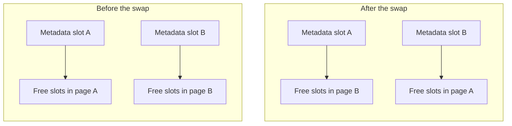

# Pin frame metadata to preserve its association with physical pages

## Problem and Root Cause: Implicit Self-Referencing Frame Metadata

Issue [#4252](https://github.com/asterinas/asterinas/issues/4252)
shows that safe code can cause a use-after-free through the slab API.
A slab owns a physical page through `UniqueFrame<Link<SlabMeta<N>>>`.
Its metadata contains a free list pointing into that page
and an allocation count that prevents releasing the page while slots remain allocated.

The page and its metadata form an implicit self-referencing object.
The metadata does not point into its own Rust fields,
but its pointers depend on its association with one particular page.
That association comes from the metadata's position in the frame metadata array,
so moving the metadata to another slot changes which page its destructor protects.



`UniqueFrame::meta_mut()` currently returns `&mut M`,
which permits replacing or swapping the whole metadata value.
For example, the following safe code moves B's free list into A's metadata slot,
then frees page B while A still refers to it:

```rust
let mut a = Slab::<64>::new().unwrap();
let mut b = Slab::<64>::new().unwrap();
core::mem::swap(&mut **a.meta_mut(), &mut **b.meta_mut());
drop(b);
let slot = a.meta_mut().alloc().unwrap(); // Reads freed page B.
```

The same unrestricted access is available through `CursorMut::current_meta()`
and through `dyn_meta_mut()` followed by a mutable `Any` downcast.
Making the metadata fields private does not close these paths:
an exclusive mutable reference still permits moving the enclosing value.

## Common Solution: Pin Metadata in Its Frame Slot

Frame metadata should remain pinned in its metadata slot until destruction.
[Rust's `Pin`](https://doc.rust-lang.org/core/pin/index.html)
expresses this contract without adding an allocation or a runtime identity check.
Metadata that depends on its location opts out of `Unpin`,
while ordinary metadata retains mutable access through `Pin::get_mut` or dereferencing.

The frame continues to store `M` directly in its existing metadata slot.
Change the mutable accessors to return pinned references:

```rust
// UniqueFrame<M>
pub fn meta_mut(&mut self) -> Pin<&mut M>;
pub fn dyn_meta_mut(&mut self) -> Pin<&mut dyn AnyFrameMeta>;

// CursorMut<'_, M>
pub fn current_meta(&mut self) -> Option<Pin<&mut M>>;

// Link<M>
pub fn project(self: Pin<&mut Self>) -> Pin<&mut M>;

// AnyFrameMeta
unsafe fn on_drop(self: Pin<&mut Self>, reader: &mut VmReader<Infallible>);
```

`Pin` wraps the reference to the metadata, not the metadata value itself.
The slab alias therefore remains `UniqueFrame<Link<SlabMeta<N>>>`;
`Link<Pin<SlabMeta<N>>>` would not express the required guarantee.
Moving a frame handle remains valid because the metadata stays in the same slot.

The frame implementation establishes pinning after moving the initial metadata into its slot.
Any initialization that creates an address dependency must happen at that final location.
Converting between unique and shared handles, inserting a frame into a list,
or removing it from a list transfers ownership without moving the metadata.

`Link` structurally pins its inner metadata and projects pinned access to that field.
Its list links can still change, but list insertion and removal must not move the inner metadata.
Keep ordinary `DerefMut` only for `M: Unpin`;
immutable metadata access remains unchanged.

Type erasure must preserve the same restriction.
Returning `Pin<&mut dyn AnyFrameMeta>` prevents safe callers from obtaining
the `&mut dyn Any` needed for a mutable downcast.
This proposal does not add a mutable downcast API;
any future version must return a pinned reference too.

Destruction must preserve pinning until the metadata's ordinary destructor runs.
Change `AnyFrameMeta::on_drop` to take `self: Pin<&mut Self>`,
update its implementations and implementation macros,
and invoke it before dropping metadata in place.
The page-table metadata callback keeps its existing child cleanup behavior
while adapting to the pinned receiver.
Frame release, `repurpose`, and `reset_as_unused` retain that ordering;
if the callback panics, they must not release or reuse the page.

Make this teardown callback unsafe to call.
The caller must exclusively own the frame being destroyed,
provide a reader positioned at that frame's beginning,
and invoke the callback only once before dropping the metadata in place.
These preconditions prevent safe code from prematurely running a destructor
with an unrelated reader through the type-erased API.

The frame callback and Rust's `Drop` serve different purposes.
`Pin::set` drops and replaces a value in place without invoking `on_drop`,
so a future metadata type that permits constructing replacement values
must maintain its safety invariants through ordinary `Drop` as well.
Document this requirement and the prohibition on moving pinned fields
in the `AnyFrameMeta` contract;
pinning does not by itself guarantee that a frame callback runs for every replaced value.

## Special Part: Changes to SlabMeta and Its Callers

Add a private `PhantomPinned` field to `SlabMeta` so that it and `Link<SlabMeta<N>>`
do not implement `Unpin`.

Keep every by-value `SlabMeta` constructor private,
and do not implement `Default`, `Clone`, or an extraction API.
Consequently, safe callers can neither move out an initialized metadata value
nor manufacture a replacement for `Pin::set`.

Construct empty metadata before allocating the frame,
then populate its free list through a pinned reference after the frame has its final address.
The constructor's internal unsafe access may update the free list and allocation count,
but must not move the metadata or expose an unrestricted mutable reference.
Construction does not add a stored page address or another heap allocation.

Change allocation to an ordinary safe method with a pinned receiver:

```rust
impl<const N: usize> SlabMeta<N> {
    pub fn alloc(self: Pin<&mut Self>) -> Result<HeapSlot, AllocError> {
        // SAFETY: Only the free list and count change; Self stays in its slot.
        let this = unsafe { self.get_unchecked_mut() };
        let slot = this.free_list.pop().ok_or(AllocError)?;
        this.nr_allocated += 1;
        Ok(slot)
    }
}
```

Keep `Slab::dealloc(&mut self, slot)` on the owning frame,
where it can continue checking that the slot belongs to the correct page.
Update its metadata access to use the pinned projection internally.
The immutable `capacity` and `nr_allocated` methods need no signature changes.

Give `SlabMeta::on_drop` the unsafe signature and pinned receiver,
and preserve its outstanding-slot check.
Because safe code cannot construct replacement slab metadata,
it cannot bypass this check using `Pin::set`.
Dropping, repurposing, or resetting a slab with outstanding slots continues to panic
before the frame can be released or reused.

Update the heap allocator to call `slab.meta_mut().project().alloc()`.
For allocation through a list cursor, reborrow its pinned metadata with
`current.as_mut().alloc()` so that allocation statistics remain available afterward.
These are safe method calls; wrapper macros are unnecessary.

Validate the change with compile-fail cases for direct metadata swaps,
whole-link swaps, cursor swaps, and mutable downcasts,
alongside attempts to construct replacement slab metadata or invoke teardown from safe code.
A safe allocator example must still compile.
Kernel tests should cover ordinary mutable metadata,
an independent address-sensitive metadata type,
frame and list ownership transfers, allocation and deallocation,
and refusal to release a slab with outstanding slots.
Run each failing teardown in its own test kernel,
since rejecting teardown deliberately retains an otherwise unrecoverable page.
Together these checks exercise both the reusable pinning contract
and the slab-specific lifetime guard.
